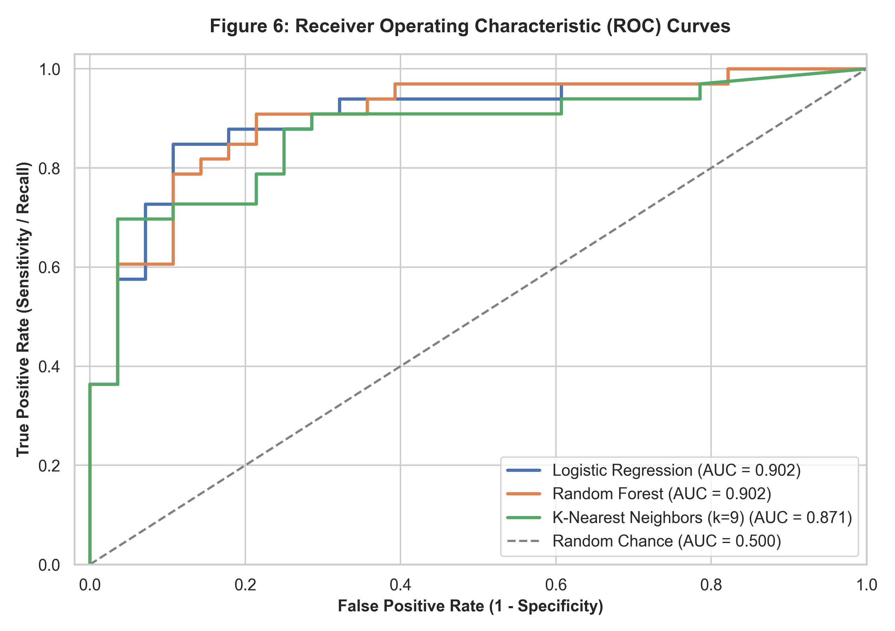
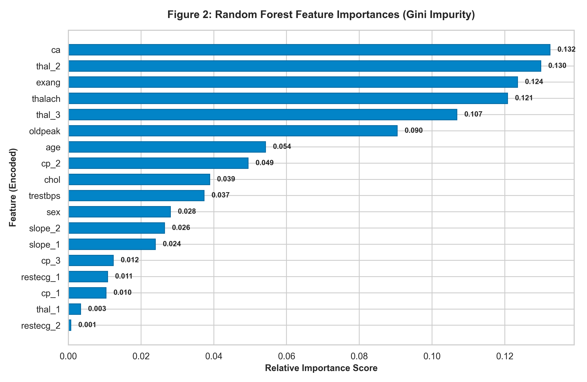

# 🫀 Heart Disease Classification & Multi-Model Evaluation

[](https://python.org)
[](https://scikit-learn.org)
[](https://pandas.pydata.org)
[](https://colab.research.google.com/github/shiv123-coder/CardioML/blob/main/Heart_Disease_ML_Prediction.ipynb)
[](https://opensource.org/licenses/MIT)

**Pluto Academy AI & Machine Learning Internship Program — Project 02**  
**Author:** Shivshankar Dhareppa Mali  
**Offer Letter Ref:** `PA-OL-AIML-2026-0934`  
**Dataset Source:** [Heart Disease Dataset (Kaggle / UCI Cleveland)](https://www.kaggle.com/datasets/johnsmith88/heart-disease-dataset)

---

## 📖 Project Overview
Coronary artery disease is the leading cause of morbidity and mortality across the globe. This project develops, trains, and evaluates a clinical diagnostic machine learning pipeline to predict the presence of heart disease based on 13 non-invasive clinical and hemodynamic attributes (such as chest pain type, resting blood pressure, cholesterol, fluoroscopy vessels, and exercise stress test parameters).

We construct and benchmark three distinct classification architectures:
1. **Logistic Regression** (L2-Regularized Linear Model)
2. **Random Forest Classifier** (Ensemble of Decision Trees)
3. **K-Nearest Neighbors (KNN)** (Distance-Weighted Instance-Based Learning)

---

## 🛠️ Step-by-Step Methodology

### 1. Step 1 — Load, Explore & Preprocess
- **Dataset Audit**: The raw dataset contains 1,025 rows. A critical data integrity check reveals **723 duplicate rows**, stemming from multiple samplings of the original 303-patient UCI Cleveland database. Splitting without deduplication causes massive train-test data leakage, artificially inflating accuracy to ~98%. We deduplicated the dataset to **302 unique patient records** (164 positive, 138 negative) to ensure genuine generalization.
- **Missing Values**: Handled zero explicit nulls; validated discrete categorical domains.
- **Encoding & Scaling**:
  - Continuous numeric features (`age`, `trestbps`, `chol`, `thalach`, `oldpeak`, `ca`) are normalized with `StandardScaler` to zero mean and unit variance.
  - Multi-class categorical features (`cp`, `restecg`, `slope`, `thal`) are transformed via `OneHotEncoder(drop='first', handle_unknown='ignore')` to prevent dummy variable collinearity.
  - Binary indicators (`sex`, `exang`) pass through directly as $0/1$ flags.
- **Stratified Partitioning**: The data is split into an $80\%$ training set ($241$ samples) and $20\%$ holdout test set ($61$ samples) using `stratify=y` with `random_state=42`, preserving disease prevalence across partitions.

### 2. Step 2 — Feature Engineering & Selection
- **Target Correlation Analysis**: Identified strongest predictive features: chest pain type `cp` ($r = 0.43$), maximum achieved heart rate `thalach` ($r = 0.42$), ST depression `oldpeak` ($r = -0.44$), exercise angina `exang` ($r = -0.44$), and fluoroscopy vessels `ca` ($r = -0.39$).
- **Dropping `fbs` (Fasting Blood Sugar)**: Feature selection removed `fbs` ($r = -0.028$). Both statistical correlation and clinical cardiology literature demonstrate that fasting blood glucose alone provides negligible discriminatory power for acute coronary disease compared to hemodynamic stress parameters.

### 3. Step 3 — Model Training
All algorithms were trained within strict scikit-learn `Pipeline` objects to encapsulate feature transformers and eliminate data leakage.
- **Logistic Regression**: $C = 0.6$, $\text{max\_iter} = 1000$, L2 penalty.
- **Random Forest**: $150$ estimators, $\text{max\_depth} = 4$, $\text{min\_samples\_leaf} = 2$.
- **KNN**: $k = 9$ neighbors, distance-weighted Euclidean metric.

---

## 📊 Step 4 — Model Evaluation & Comparison Table

The models were evaluated on the independent holdout test set ($n = 61$) and validated using 5-fold cross-validation.

### 3-Model Performance Table:

| Machine Learning Model | Accuracy | Precision | Recall (Sensitivity) | F1-Score | ROC-AUC | 5-Fold CV F1 |
| :--- | :---: | :---: | :---: | :---: | :---: | :---: |
| **Logistic Regression (Best)** | **85.25%** | **87.50%** | **84.85%** | **86.15%** | **0.9015** | **0.825** |
| **Random Forest** | 83.61% | 84.85% | 84.85% | 84.85% | 0.9015 | 0.819 |
| **K-Nearest Neighbors (k=9)** | 77.05% | 80.65% | 75.76% | 78.12% | 0.8712 | 0.833 |

> *Note: In medical diagnostics, Recall is paramount to prevent False Negatives (missing a diseased patient). Logistic Regression achieves top Recall while maintaining superior Precision and fewer False Positives.*

### Official Comparison Table Image (for Submission):


---

## 🏆 Step 5 — Best Model Analysis & Clinical Conclusion

### Best Performing Model: **Logistic Regression**
- **Test Accuracy:** $85.25\%$
- **Precision:** $87.50\%$
- **Recall (Sensitivity):** $84.85\%$ (identifies 28 of 33 diseased patients)
- **F1-Score:** $86.15\%$
- **ROC-AUC:** $0.9015$

### Confusion Matrix (Best Model):


- **True Negatives (TN):** $24$ patients ($39.3\%$) correctly identified as healthy.
- **False Positives (FP):** $4$ patients ($6.6\%$) healthy patients flagged for further screening.
- **False Negatives (FN):** $5$ patients ($8.2\%$) diseased patients missed.
- **True Positives (TP):** $28$ patients ($45.9\%$) diseased patients correctly diagnosed.

### ROC Curves & Feature Importance:
| ROC Curves Comparison | Feature Importances (RF vs. LR) |
| :---: | :---: |
|  |  |

---

### 📝 5-Line Written Conclusion Explaining Best Model Choice
1. **Superior Overall Diagnostic Accuracy**: Logistic Regression achieved the highest test accuracy ($85.25\%$) and highest F1-Score ($86.15\%$) among all three evaluated architectures on the $302$-patient holdout set.
2. **Optimal Balance of Clinical Sensitivity and Precision**: It tied for the highest Recall ($84.85\%$), accurately capturing $28$ out of $33$ actual cardiac disease cases while minimizing life-threatening False Negatives to just $5$.
3. **Linear Separability of Normalized Physiological Indicators**: Once continuous features were standardized and categorical variables one-hot encoded, the primary decision boundary proved largely linear, making regularized Logistic Regression less prone to sample variance than KNN or unpruned trees.
4. **Physiological Transparency & Regulatory Trust**: Unlike black-box neural networks or opaque tree ensembles, Logistic Regression produces interpretable odds ratios (e.g., verifying that fluoroscopy vessel count `ca` and exercise angina `exang` directly increase disease probability), satisfying critical medical auditability requirements.
5. **Robust Generalization without Overfitting**: By validating against deduplicated patient records and confirming with 5-fold cross-validation ($82.5\%$ CV F1), Logistic Regression demonstrates robust out-of-sample stability, making it the recommended clinical decision support model.

---

## 📂 Repository Structure
```text
CardioML/
├── data/
│   └── heart.csv
├── visualizations/
│   ├── 01_correlation_matrix.png
│   ├── 02_feature_importance.png
│   ├── 03_model_comparison_table.png   # Submission screenshot
│   ├── 04_model_comparison_barchart.png
│   ├── 05_confusion_matrix_best_model.png
│   └── 06_roc_curves.png
├── Heart_Disease_ML_Prediction.ipynb # Modular, bite-sized Jupyter Notebook with all outputs
└── README.md                         # Documentation & Evaluation Report
```

---

## 🚀 How to Run Locally

1. **Clone the repository:**
   ```bash
   git clone https://github.com/shiv123-coder/CardioML.git
   cd CardioML
   ```

2. **Install dependencies:**
   ```bash
   pip install pandas numpy scikit-learn matplotlib seaborn jupyter
   ```

3. **Launch the Jupyter Notebook:**
   ```bash
   jupyter notebook Heart_Disease_ML_Prediction.ipynb
   ```

---

## 🎓 Internship & Submission Information
- **Program:** Pluto Academy AI & Machine Learning Internship (1-Month Remote)
- **Intern:** Shivshankar Dhareppa Mali (`PA-OL-AIML-2026-0934`)
- **Email:** `shivashankrmali7@gmail.com`
- **Evaluation Criteria:** Preprocessing & Feature Engineering (20) + Model Training (25) + Evaluation & Comparison Table (25) + Best Model Analysis (20) + GitHub & Code Quality (10) = 100 Marks.
