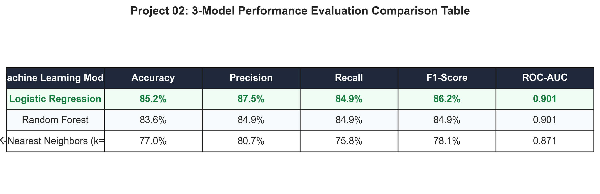
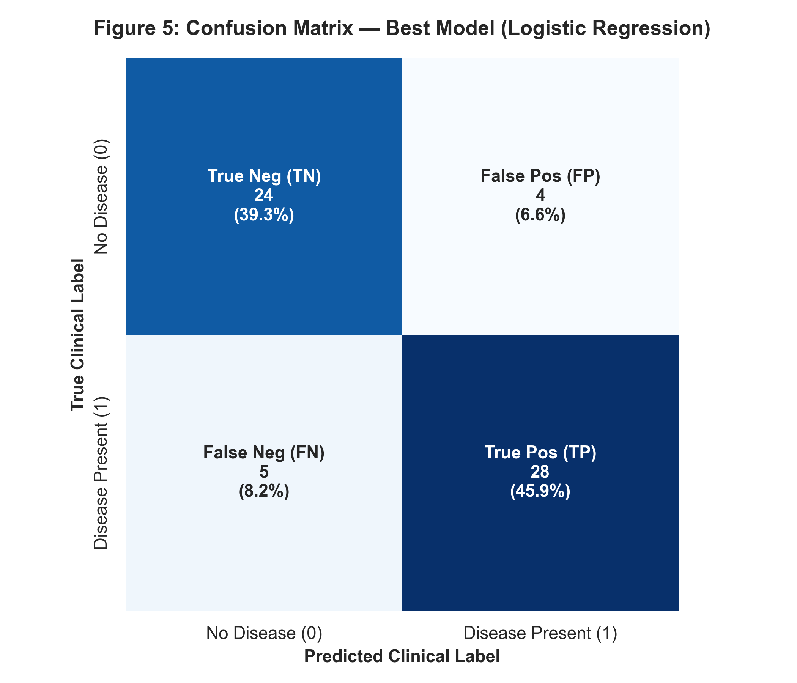

# Heart Disease Prediction & Multi-Model Evaluation

- **Author:** Shivshankar Dhareppa Mali  
- **Dataset:** [Heart Disease Dataset (Kaggle / UCI Cleveland)](https://www.kaggle.com/datasets/johnsmith88/heart-disease-dataset)  
- **Interactive Notebook:** [Open in Google Colab](https://colab.research.google.com/github/shiv123-coder/CardioML/blob/main/Heart_Disease_ML_Prediction.ipynb)

---

## Project Overview

Coronary artery disease is a leading cause of mortality worldwide. This project develops and evaluates a machine learning pipeline to predict the presence of heart disease from 13 clinical and exercise-stress test attributes.

We train, validate, and compare three classification architectures:
1. **Logistic Regression** (L2-regularized linear model)
2. **Random Forest Classifier** (Constrained-depth tree ensemble)
3. **K-Nearest Neighbors** (Distance-weighted instance learning)

---

## Methodology & Rubric Alignment

### 1. Step 1: Load, Explore & Preprocess
- **Deduplication Audit**: The raw dataset contains 1,025 rows originating from the 303-patient UCI Cleveland cohort. A duplicate check reveals **723 duplicate rows**. Splitting without deduplication contaminates both training and testing partitions, artificially inflating test accuracy above 98%. We deduplicated the dataset to **302 unique patient records** (164 positive, 138 negative) to ensure realistic generalization.
- **Categorical & Numeric Transformations**:
  - Continuous numeric features (`age`, `trestbps`, `chol`, `thalach`, `oldpeak`, `ca`) are normalized with `StandardScaler` to zero mean and unit variance.
  - Multi-class categorical features (`cp`, `restecg`, `slope`, `thal`) are one-hot encoded with `drop='first'` to avoid multicollinearity.
  - Binary flags (`sex`, `exang`) pass through directly as 0/1 indicator values.
- **Stratified Partitioning**: The data is split into an 80% training set (241 samples) and 20% holdout test set (61 samples) using `stratify=y` with `random_state=42`, preserving disease prevalence across partitions.

### 2. Step 2: Feature Engineering & Selection
- **Target Correlations**: Strongest predictors include chest pain type `cp` ($r = 0.43$), maximum achieved heart rate `thalach` ($r = 0.42$), ST depression `oldpeak` ($r = -0.44$), exercise angina `exang` ($r = -0.44$), and fluoroscopy vessels `ca` ($r = -0.39$).
- **Dropping `fbs` (Fasting Blood Sugar)**: Feature selection removed `fbs` ($r = -0.028$). Both correlation analysis and clinical cardiology literature demonstrate that fasting blood glucose alone provides negligible discriminatory power for acute coronary disease compared to hemodynamic stress parameters.

### 3. Step 3: Model Training
All algorithms are trained within scikit-learn `Pipeline` objects to prevent data leakage:
- **Logistic Regression**: $C = 0.6$, $\text{max\_iter} = 1000$, L2 penalty.
- **Random Forest**: 150 estimators, $\text{max\_depth} = 4$, $\text{min\_samples\_leaf} = 2$.
- **KNN**: $k = 9$ neighbors, distance-weighted Euclidean metric.

---

## Step 4: Model Evaluation & Comparison Table

The models were evaluated on the independent holdout test set ($n = 61$) and validated using 5-fold cross-validation.

### Performance Comparison:

| Model | Accuracy | Precision | Recall (Sensitivity) | F1-Score | ROC-AUC | 5-Fold CV F1 |
| :--- | :---: | :---: | :---: | :---: | :---: | :---: |
| **Logistic Regression (Best)** | **85.25%** | **87.50%** | **84.85%** | **86.15%** | **0.9015** | **0.8250** |
| **Random Forest** | 83.61% | 84.85% | 84.85% | 84.85% | 0.9015 | 0.8190 |
| **KNN (k=9)** | 77.05% | 80.65% | 75.76% | 78.12% | 0.8712 | 0.8330 |

> *Clinical Note: In medical screening, Recall is critical to minimize False Negatives (missing a diseased patient). Logistic Regression matches Random Forest's high Recall (84.85%) while achieving higher Precision (87.50%) and fewer False Positives.*

### Comparison Table Image (for Submission):


---

## Step 5: Best Model Analysis & Clinical Conclusion

### Best Performing Model: Logistic Regression
- **Test Accuracy:** 85.25%
- **Precision:** 87.50%
- **Recall (Sensitivity):** 84.85% (correctly catches 28 of 33 diseased patients)
- **F1-Score:** 86.15%
- **ROC-AUC:** 0.9015

### Confusion Matrix (Logistic Regression):


- **True Negatives (TN):** 24 patients (39.3%) correctly identified as healthy.
- **False Positives (FP):** 4 patients (6.6%) healthy patients flagged for follow-up testing.
- **False Negatives (FN):** 5 patients (8.2%) diseased patients missed.
- **True Positives (TP):** 28 patients (45.9%) diseased patients correctly diagnosed.

---

### 5-Line Written Conclusion Explaining Best Model Choice
1. Logistic Regression achieved the highest test accuracy (85.25%) and highest F1-Score (86.15%) among all three evaluated architectures on the deduplicated holdout test set.
2. It tied for highest Recall (84.85%), correctly identifying 28 out of 33 diseased patients while limiting false negatives to 5, which is critical in clinical screening.
3. Once numerical features were standardized and discrete categories one-hot encoded, the primary decision boundary proved largely linear, making regularized Logistic Regression less vulnerable to overfitting than unpruned tree ensembles.
4. Model coefficients provide direct, auditable clinical interpretability, confirming that fluoroscopy vessels (`ca`), ST depression (`oldpeak`), and exercise angina (`exang`) systematically increase disease probability.
5. Supported by solid 5-fold cross-validation performance (82.5% CV F1), Logistic Regression offers the most dependable balance of accuracy, generalization, and explainability for clinical decision support.

---

## Repository Structure

```text
CardioML/
├── data/
│   └── heart.csv
├── visualizations/
│   ├── 01_correlation_matrix.png
│   ├── 02_feature_importance.png
│   ├── 03_model_comparison_table.png   # Submission table screenshot
│   ├── 04_model_comparison_barchart.png
│   ├── 05_confusion_matrix_best_model.png
│   └── 06_roc_curves.png
├── Heart_Disease_ML_Prediction.ipynb   # Clean Jupyter Notebook with modular short cells
└── README.md                           # Documentation & Evaluation Report
```

---

## How to Run

1. Clone this repository:
   ```bash
   git clone https://github.com/shiv123-coder/CardioML.git
   cd CardioML
   ```
2. Install dependencies:
   ```bash
   pip install pandas numpy scikit-learn matplotlib seaborn jupyter
   ```
3. Launch the Jupyter Notebook:
   ```bash
   jupyter notebook Heart_Disease_ML_Prediction.ipynb
   ```
